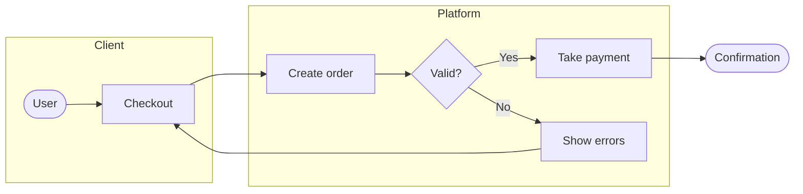
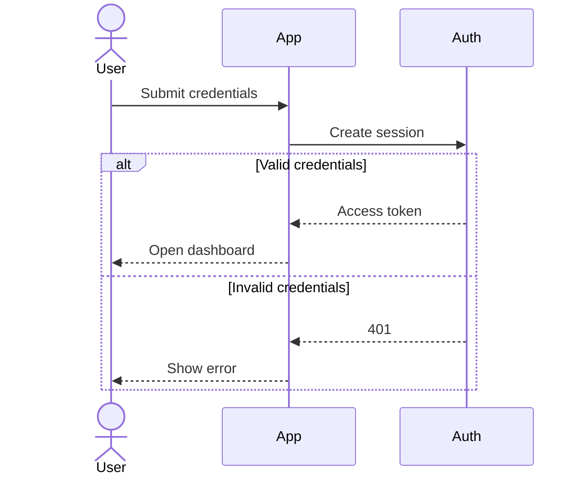
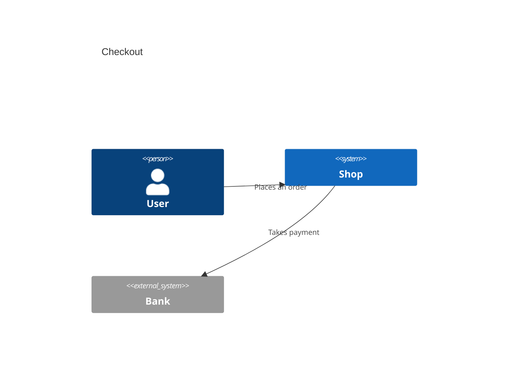
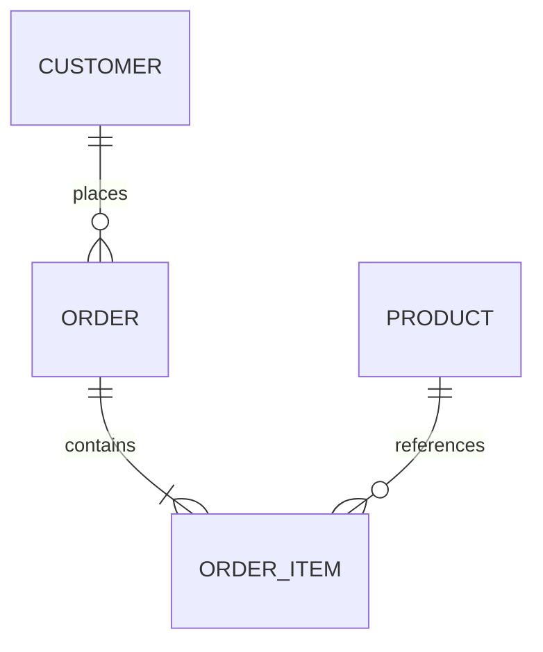
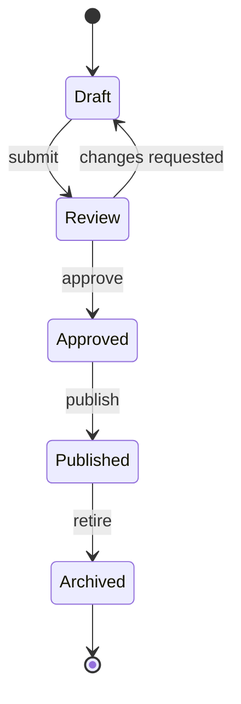
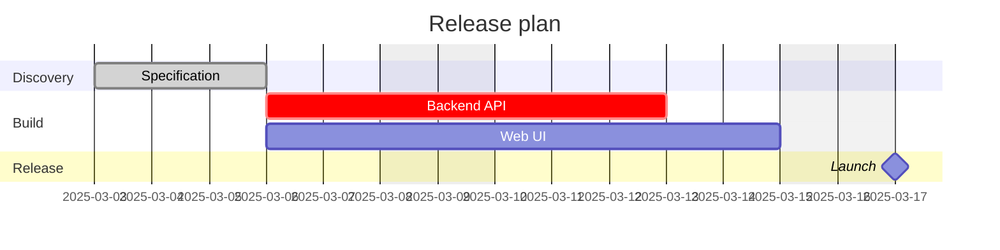
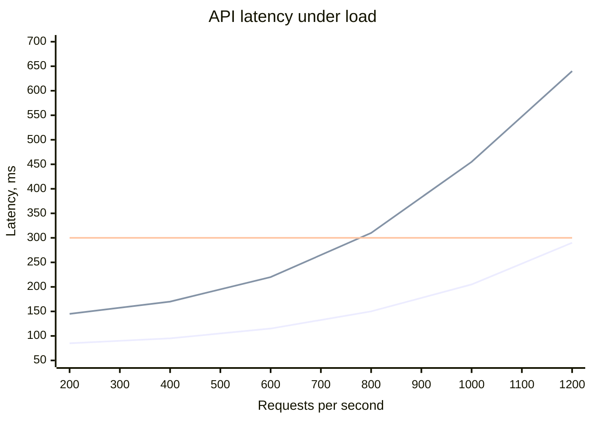
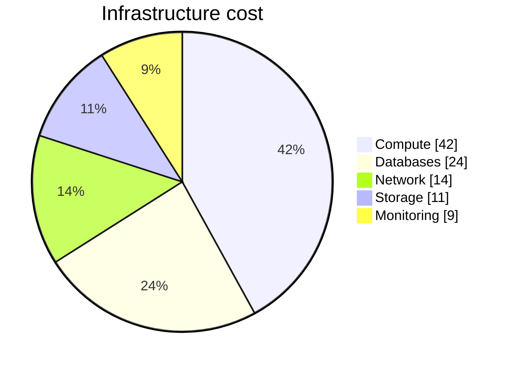

# Mermaid

Make the visualization part of the ordinary Markdown answer: a fenced `mermaid` block next to the short prose it clarifies. Do not create a separate artifact unless the user asks for one.

## Choose by meaning

- Process, branching, dependencies, data flow → `flowchart`
- Calls and interactions over time → `sequenceDiagram`
- Domain structure or data model → `classDiagram` or `erDiagram`
- Lifecycle and transitions → `stateDiagram-v2`
- Architecture → `C4Context`, `C4Container`, or a flowchart with subgraphs
- Roadmap and schedule → `timeline` or `gantt`
- Hierarchy and decomposition → `mindmap`
- Work and prioritization → `kanban` or `quadrantChart`
- Quantitative comparison → `xychart`, `pie`, or `radar-beta`
- Flow of quantities between stages → `sankey-beta`
- Binary or protocol layout → `packet-beta`
- Part-to-whole layout in one box → `treemap-beta`
- Service layout with explicit boundaries → `architecture-beta`
- Commit and branch history → `gitGraph`

Do not force every idea into a flowchart. Pick the grammar whose semantics match the relationship.

## Rules

- Show one useful idea per diagram; split when crossings or density hide the point.
- Preserve truthful order, direction, cardinality, boundaries, units, and scale. Never invent data to make a chart look complete.
- Use real labels from the task. Add subgraphs, participants, states, series names, and notes only when they carry meaning.
- For charts, label units, choose an honest axis range, and name every series. Use color as reinforcement, not as the only carrier of meaning.
- Keep the surrounding prose short and do not narrate what the diagram already makes obvious.
- Fail visibly: when a grammar cannot express the relationship or the renderer cannot draw it, say so instead of silently substituting a weaker picture.
- Mermaid is for compact inline explanation, not polished interactive charts, geographic maps, or spatial UI mockups.

## Rendering in this repository

A fence in an answer or a Markdown file renders as a diagram card once the reply settles: sanitized SVG under a named `role="img"` wrapper, a **Source** toggle, a **Copy** action, and a full-screen viewer that opens the diagram at the chat scale with the catalog zoom and scrolls what overflows. Where the `ui-mermaid` row is disabled in the profile, the fence stays a plain code block; the syntax below is valid either way.

The renderer fixes these constraints, so do not fight them:

- Mermaid runs with `htmlLabels: false` globally, and its output passes DOMPurify with `FORBID_TAGS: ['foreignObject']`; every `<use>` reference is cut. HTML labels, embedded SVG icons, and grammars that emit foreign objects cannot be drawn.
- Theme colors come from the application's `--dsw-*` tokens. Do not set per-diagram `config`, `themeVariables`, or `themeCSS` frontmatter: hardcoded colors break the dark theme, and the renderer already owns label measurement.
- The diagram base font is 13px in every theme, and a diagram is fitted to the column only down to 0.85 of its natural width; below that it keeps its natural width and scrolls inside the card. Keep labels short and prefer a second diagram over one very wide one.
- A parse error, an unsupported grammar, or a render left without visible text degrades to the code block with a notice. That is the visible failure; do not hide it by simplifying the diagram without saying so.

Verified against the shipped renderer on 2026-11-19: `flowchart`, `sequenceDiagram`, `classDiagram`, `erDiagram`, `stateDiagram-v2`, `C4Context`, `C4Container`, `timeline`, `gantt`, `mindmap`, `kanban`, `quadrantChart`, `xychart`, `pie`, `packet-beta`, `architecture-beta`, `sankey-beta`, `radar-beta`, `treemap-beta`, `gitGraph` all draw a card. `block-beta` and `zenuml` degrade to the code block: ZenUML is a separate renderer plugin that the bundle does not ship, and `block-beta` does not survive this pipeline. The beta chart grammars draw with mermaid's own palettes rather than the theme tokens, so prefer a core grammar when the diagram must match the interface colors.

## Examples

Process with boundaries:

Interaction with alternatives:

Architecture in C4:

Relational data model:

Lifecycle with explicit transitions:

Schedule with dependencies and a milestone:

Chart with named series and non-zero axes:

Part-to-whole comparison:

## Documentation

- [Mermaid documentation](https://mermaid.js.org/intro/)
- [Diagram syntax reference](https://mermaid.js.org/intro/syntax-reference.html)
- [Mermaid Live Editor](https://mermaid.live/)

Adapted from [toolittlecakes/mermaid-skill](https://github.com/toolittlecakes/mermaid-skill) (MIT, see [LICENSE](LICENSE)): the upstream bb-IDE frontmatter, C4/ZenUML support notes outside this renderer, and the unverified grammar list are replaced by this repository's measured constraints.