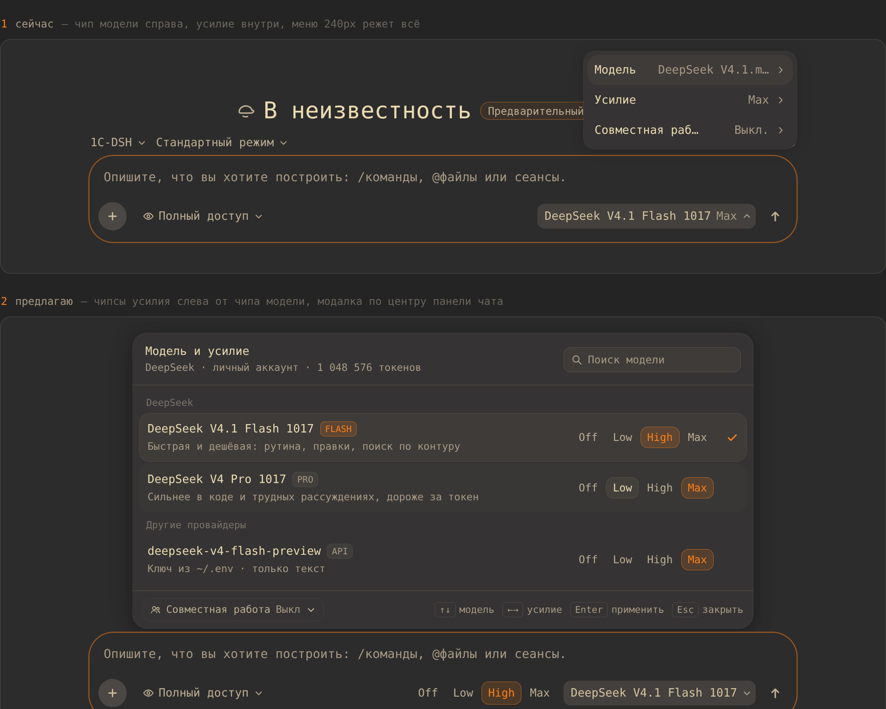

# Composer model picker and effort chips (fork-local)

This page records the one fork-local change that replaces an upstream interface instead of adding to it: the composer's model seat no longer opens a two-level menu (`Model ›` / `Effort ›` / plugin rows) and now shows the model chip with the current model's reasoning levels beside it, while clicking the chip opens a dialog that lists every model with its description and all of its levels. The behavior itself is documented for users in [the package README](../../packages/client/ui-model-selection/README.md); this page exists so an upstream merge cannot silently restore the old surface.

## What the patch touches

- [ModelSelect.tsx](../../packages/client/ui-model-selection/src/client/ModelSelect.tsx) — the seat renders the effort chips and the model chip, and the picker is a `Modal` dialog instead of the `MenuSurface` drill-down. The dialog centres over the conversation column: the seat reads the composer card's rectangle once per opening and shifts the card with a translate. A plugin pane unfolds below its footer entry instead of replacing the model list, and the card caps its own height so the taller footer cannot push it off-screen.
- [index.ts](../../packages/client/ui-model-selection/src/client/index.ts) — registers three application commands (`model.picker` on Ctrl/Cmd+Alt+M, `model.effortNext` and `model.effortPrevious` on Ctrl/Cmd+Alt+E) matched on `event.code`, and publishes picker requests through a plugin-owned observable the seat binds as `usePickerRequest`.
- [slots.ts](../../packages/client/ui-model-selection/src/client/slots.ts) — `ModelLabelOwner.placement` drops the dead `'menu'` member, and the injected face carries `sessionId`, `hooks.pickerRequest`, and `clearPickerRequest`.
- [Model.tsx](../../packages/client/ui-primitives/src/Modal.tsx) — `Modal` accepts an inline `style` for the dialog card, so a caller can place it over a panel rather than the viewport.
- [binding.ts](../../packages/client/shortcuts/src/binding.ts) — `fork-patch: web-alt-shortcuts` admits Ctrl/Cmd+Alt and any three-modifier gesture to the browser allowlist, so the same chords work in a tab and in the desktop shell; plain Alt stays rejected and the adapter's AltGraph guard still drops layout-composed input. [configuration.client.spec.ts](../../packages/client/shortcuts/tests/configuration.client.spec.ts) records the fork's expectation there.
- [locale dictionaries](../../packages/client/ui-model-selection/src/client/locales.ts) — `menu.close`, `menu.current`, `menu.keyApply`, `menu.keyClose`, `menu.back`, and the `shortcut.*` labels, in every shipped language.

The plugin slots keep their contracts: `conversation.input.model.options` now renders in the dialog footer, and `conversation.input.model.pane` unfolds inside that footer, keeping the model list visible and returning focus to the entry that folded it; the options owner also carries `openPaneKey` so an entry can mark itself expanded. The agent-team contribution uses neither: it is a bare switch beside the key hints, with the name, state, and cost in its tooltip.

## Design record

The session that produced this patch started from the stock seat: a 240px card whose first level is a router (`Model ›`, `Effort ›`, plugin rows), where the effort level therefore sits three clicks away and every value ellipsizes. The recording below is the shorthand of what was decided, so the reasoning survives without the transcript.

- **One screen, one decision.** The picker opens on the model list; every row carries its own levels. The router level is gone because it conveyed nothing the two rows did not already say.
- **Chips in the composer.** The current model's levels are visible at all times next to the model chip, so a common change costs one click. They sit to the right of the chip, matching the composer's trailing control cluster.
- **A dialog, not a menu.** The card centres over the conversation column: a side panel moves that column's centre away from the window's, so a viewport-centred card reads as belonging to the wrong surface.
- **Keyboard first, layout second.** The gesture matches `event.code`, so it survives a Cyrillic layout, and the fork admits `primary+alt` to the browser allowlist: the stock policy left three gestures usable in a tab, none of them the ones this seat needs.
- **Plugin settings move to the footer.** The agent-team switch used to be the third router row; it reads better as a control beside the key hints than as a nested menu. A caption row was tried and rejected: the footer keeps the switch alone, and the hover tooltip carries the name, the saved state, and what the mode costs, so the list never loses a row to a heading.

Two defects surfaced while the change was under test and are fixed here: the `conversation.input.model.options` slot was declared but never rendered (the agent-team switch would have vanished), and closing one seat's picker retired a picker request belonging to another Session in a split view.

## Merge control

An upstream merge that rewrites these files can drop the picker without a conflict, because the patch rewrites existing components rather than adding new ones. The guard is a marker file plus a check:

- Every patched file carries `fork-patch: composer-model-picker` in its header comment.
- `pnpm run fork:patch-check` (in [scripts/check-fork-patches.ts](../../scripts/check-fork-patches.ts)) asserts each marker still exists, and `scripts/fork-merge-ritual.sh` runs it as its first audit step after the merge.
- After an upstream rewrite, restore the markers with the picker rather than deleting the check; a file that legitimately loses the fork behavior requires removing its entry from the script's table in the same commit, which is what makes the removal visible in review.
