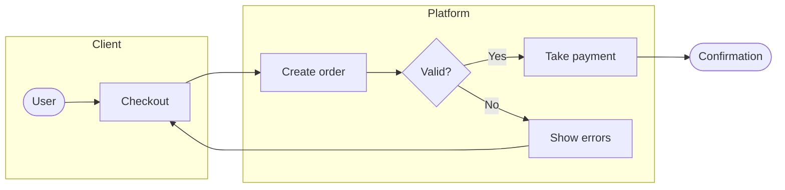
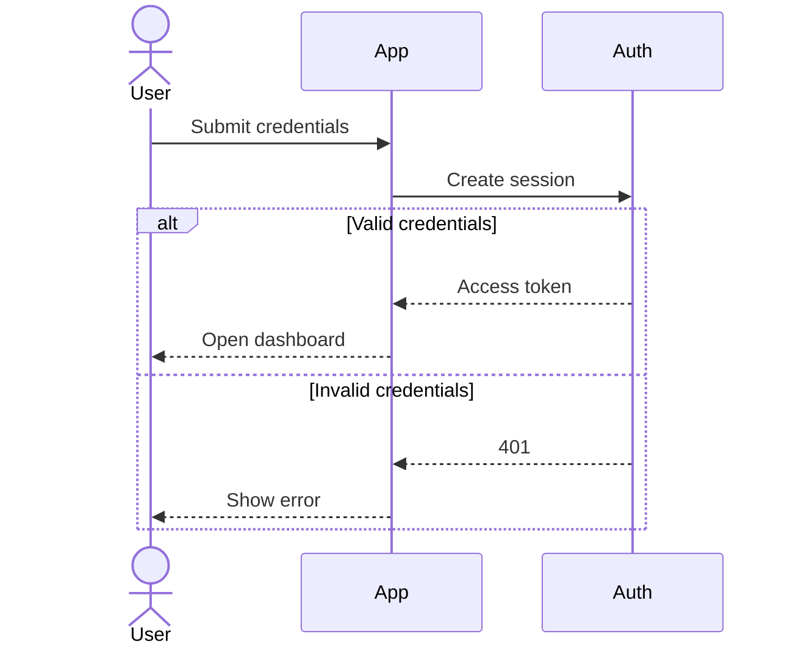
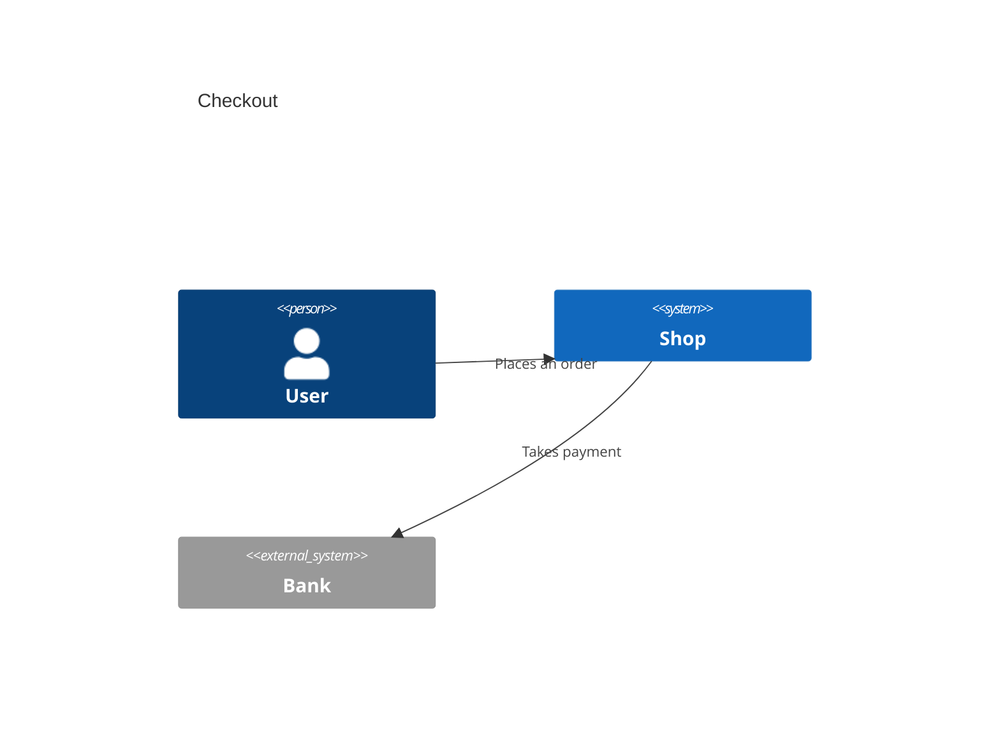
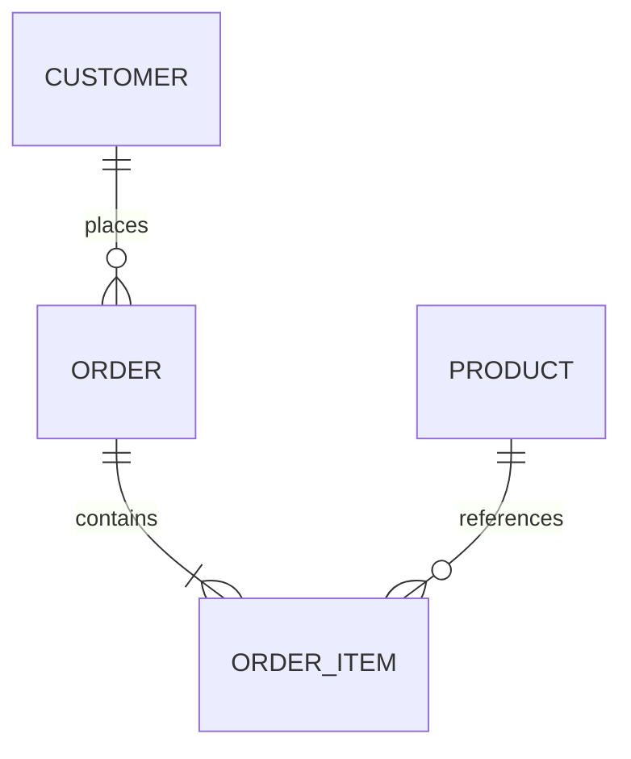
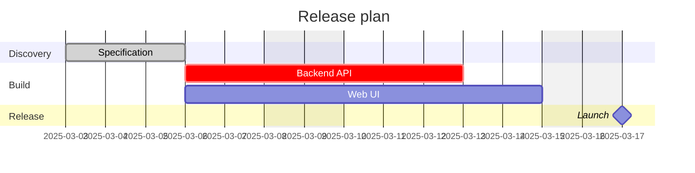
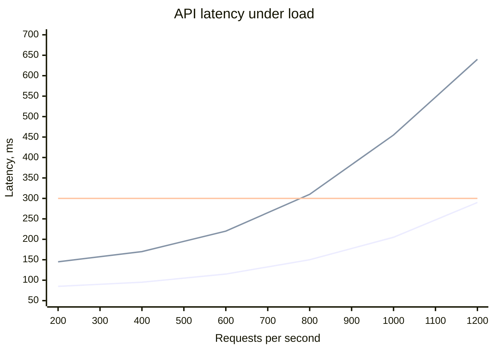

# Mermaid

A fenced `mermaid` block belongs next to the short prose it clarifies, inside the ordinary answer or Markdown file. Do not create a separate artifact unless the user asks for one, and do not draw what a sentence states better.

## Choose the grammar by the relationship

- Process, branching, dependency, data flow → `flowchart`
- Calls and interactions over time → `sequenceDiagram`
- Domain model or data structure → `classDiagram` or `erDiagram`
- Lifecycle and transitions → `stateDiagram-v2`
- Architecture with people, systems, or containers → `C4Context` or `C4Container`
- Roadmap or schedule → `timeline` or `gantt`
- Hierarchy or decomposition → `mindmap`
- Work moving through stages → `kanban`
- Prioritization on two axes → `quadrantChart`
- Quantitative comparison over a range → `xychart`, or `pie` for a single whole
- Quantity flowing between stages → `sankey-beta`
- Binary or protocol layout → `packet-beta`
- Part-to-whole layout in one box → `treemap-beta`
- Services with explicit boundaries → `architecture-beta`
- Commit and branch history → `gitGraph`

Pick the grammar whose semantics match the relationship; a flowchart is the fallback, not the default.

## Rules

- One useful idea per diagram. Split it when crossings or density hide the point.
- Preserve truthful order, direction, cardinality, boundaries, units, and scale. Never invent data to complete a chart.
- Use labels from the task itself. Add subgraphs, participants, states, series, and notes only when they carry meaning.
- For charts, label units, name every series, and choose an honest axis range.
- Keep the surrounding prose short, and do not narrate what the diagram already shows.
- Fail visibly. When a grammar cannot express the relationship or the renderer cannot draw it, say so instead of quietly substituting a weaker picture.
- Mermaid is for compact inline explanation, not polished dashboards, geographic maps, or spatial UI mockups.

## What this renderer draws

Verified against the shipped pipeline: `flowchart`, `sequenceDiagram`, `classDiagram`, `erDiagram`, `stateDiagram-v2`, `C4Context`, `C4Container`, `timeline`, `gantt`, `mindmap`, `kanban`, `quadrantChart`, `xychart`, `pie`, `packet-beta`, `architecture-beta`, `sankey-beta`, `radar-beta`, `treemap-beta`, and `gitGraph` draw a diagram card.

Two do not: `block-beta` degrades to the source block, and `zenuml` is a separate renderer plugin that this bundle does not ship. A fence that fails to parse shows the source with a notice; that notice is the renderer telling the reader the diagram did not draw, not a permission to simplify.

## Keep diagrams readable

The renderer fixes these constraints, so work with them instead of around them:

- Mermaid runs with `htmlLabels: false`, and its output passes a sanitizer that removes `foreignObject` and every `<use>` reference. HTML labels, embedded icons, and grammars that emit those cannot be drawn.
- Colors come from the application theme. Do not set per-diagram `config`, `themeVariables`, or `themeCSS` frontmatter: hardcoded colors break the dark theme, and label measurement is already owned by the renderer.
- The diagram font is 13px in every theme, and the card fits a diagram to the column only down to 0.85 of its natural width; below that it keeps natural width and scrolls horizontally. Keep labels short, and prefer two diagrams over one very wide row.
- A card opens a full-screen viewer at the chat scale with the zoom toolbar and scrollbars, so a dense diagram stays readable at 1:1 without shrinking the transcript.

## Examples

Process with boundaries:

Interaction with alternatives:

Architecture:

Relational data model:

Schedule with dependencies and a milestone:

Chart with named series and non-zero axes:

## When not to use it

Skip the diagram when the fact is a single sentence, when the data is missing (an invented chart is worse than prose), or when the reader needs exact values — put those in a table or list next to it.